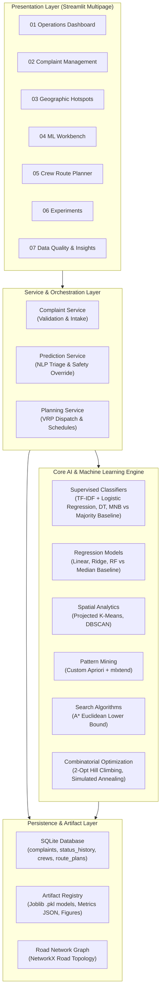

# GrievanceRoute — System Architecture Specification

## 1. Executive Summary
**GrievanceRoute** is an AI-assisted civic complaint triage and repair crew routing system tailored to the municipal operating environment of Pune, Maharashtra. It bridges classical artificial intelligence state-space search with modern supervised text classification, regression forecasting, and unsupervised spatial clustering.

---

## 2. Multi-Tier Architectural Layers

---

## 3. End-to-End Operational Lifecycle

1. **Citizen Complaint Intake**:
   - The citizen or municipal operator submits a free-text grievance through the validated complaint form.
   - Geographic coordinates, Pune zone, and meteorological conditions are captured.
2. **Deterministic Validation & NLP Preprocessing**:
   - Validates minimum description length ($\ge 10$ characters) and geographical bounds (Lat 18.40–18.65, Lon 73.70–74.00).
   - Strips whitespace, normalizes casing, and filters out malformed coordinate anomalies.
3. **ML Classification & Safety-Critical Rules**:
   - The TF-IDF + Logistic Regression pipeline infers the complaint category (`pothole`, `water leak`, `streetlight`, `garbage`) with calibrated class probability.
   - Deterministic keyword rules inspect safety hazards (e.g., `"live wire"`, `"transformer blast"`, `"sparking"`). If matched, the system triggers an emergency override to `streetlight`, sets maximum urgency ($5/5$), and flags a supervisor warning.
4. **Urgency & Resolution Forecasting**:
   - Multi-target regression estimates continuous urgency score and expected resolution duration (hours) evaluated against a Median Baseline.
5. **Spatial Grouping & Density Hotspots**:
   - Projected metric coordinates $(x_{\text{km}}, y_{\text{km}})$ feed into K-Means and DBSCAN to detect dense incident corridors across Pune.
6. **Constrained Multi-Crew Routing (VRP)**:
   - Evaluates crew skill specialization, capacity limits, and 8-hour shift budgets.
   - Simulated Annealing and 2-Opt Hill Climbing optimize tour permutations to minimize total travel distance, unserved urgency penalties, and overtime.
7. **Persistence & Lifecycle Auditing**:
   - Grievances, dispatch schedules, and state transitions (`Pending` $\rightarrow$ `Assigned` $\rightarrow$ `In Progress` $\rightarrow$ `Resolved`) persist cleanly in SQLite with complete audit history.
